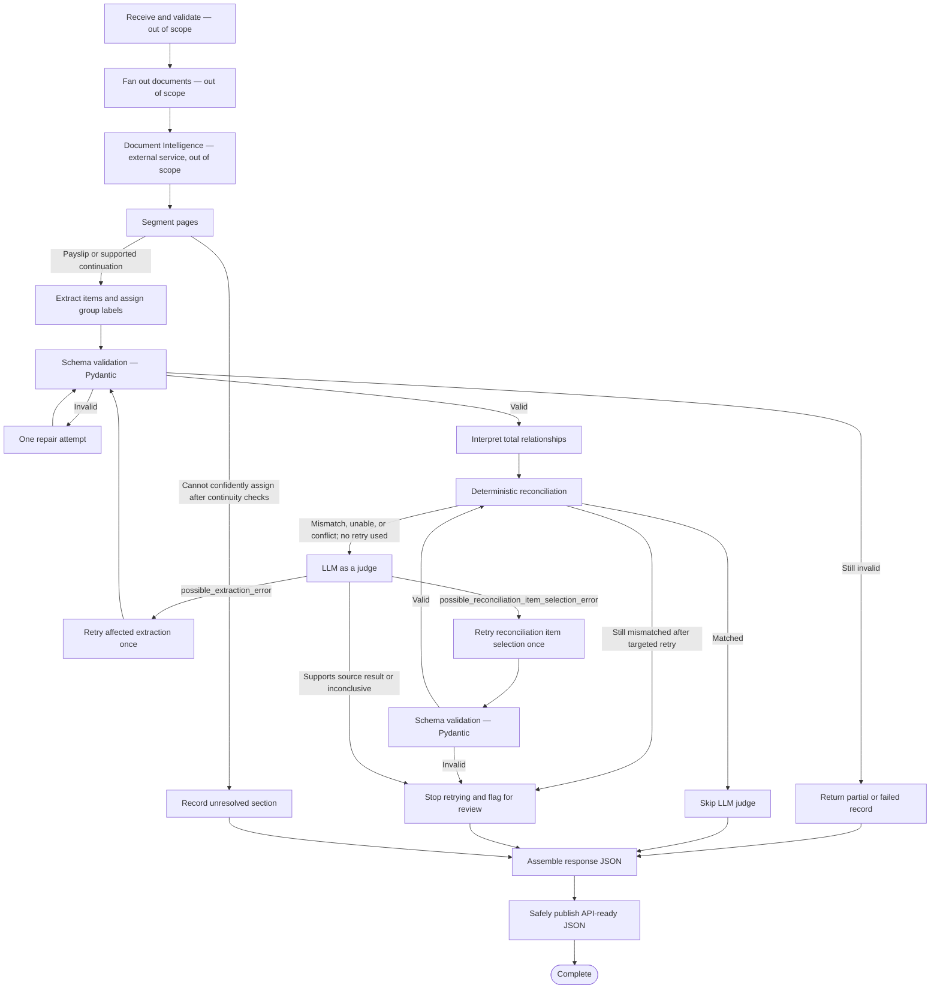

# Wage Extraction Agent - Prototype Design Specification

Status: **Accepted local mock prototype - complete**  
Owner: Data Scientist  
Last updated: 8 November 2026  
Approval record: The Data Scientist explicitly approved the complete local mock-prototype design and authorised implementation on 8 November 2026. Project foundation, schemas/state, versioned mock adapters, all twelve approved LangGraph nodes, dynamic edges, bounded repair/retries, fan-out/fan-in, atomic JSON publication and the external versioned prompt bundle are implemented. All 37 collected tests passed on 8 November 2026. Live model invocation remains unimplemented. Approval does not authorise Azure deployment, Jade integration or production-data processing.

## 1. Purpose and scope

The prototype converts one or more payslip PDFs into lossless structured data for workers compensation case managers. Its agent boundary ends with API-ready JSON representing the future response to Jade.

Document receipt/preprocessing and the internal design of Azure AI Document Intelligence are owned by AI Engineering. The wage agent assumes the external Document Intelligence service exists and consumes its OCR/layout response through an adapter contract. Anything after the API-ready JSON is returned, including spreadsheet generation or Jade presentation, is outside the wage agent's scope.

The agent extracts and groups pay information. It does not estimate wages, calculate claim benefits, determine entitlement, accept or reject claims, or automatically correct source values.

Arithmetic is allowed only to compare extracted items with totals printed on the source document.

## 2. Current state and approved decisions

- **Implemented:** Sample review workbook and synthetic test fixtures only. No agent workflow or live integration exists.
- **Approved:** Use Python and LangGraph for prototype orchestration.
- **Approved:** Process every received file, payslip and item independently where possible. One failure must not stop the remaining work.
- **Approved:** Assume an AI Engineering-owned Azure AI Document Intelligence service exists; its internal design and operation are out of scope. The wage agent consumes its response through an adapter contract.
- **Approved:** Use mock Document Intelligence responses and GPT adapters in the prototype because no endpoints or credentials are available.
- **Approved:** End the wage-agent boundary with API-ready JSON. Spreadsheet generation and downstream Jade presentation are out of scope.
- **Approved:** Use a hybrid schema: stable common fields plus flexible fields that preserve unfamiliar source labels and values.
- **Approved:** Preserve duplicates and conflicting values. Do not silently deduplicate, choose between conflicts, or infer missing amounts.
- **Approved:** Keep multiple employers separate, even for the same employee.
- **Approved:** Keep clearly extracted records unflagged. Flag only a specific issue requiring review.
- **Approved:** Use exact arithmetic reconciliation. Every nonzero difference is a mismatch.
- **Approved:** Describe a mismatch as a possible rounding difference only when rounding could explain it. Mark it confirmed only when source evidence proves this.
- **Approved:** Default to AUD when supported by the document or supplied context; allow other currencies.
- **Approved:** Upstream preprocessing owns duplicate-request detection. The agent processes every invocation that reaches it, even when the request ID or content was processed previously; it does not cache or reuse a prior result.
- **Approved external dependency:** Documents are de-identified before they reach the agent. The upstream/AI Engineering solution owns and verifies that preprocessing control.
- **Deferred:** Jade transport, job status, authentication, deployment and callback/API design.
- **Deferred to AI Engineering:** Live Azure connection tests and production platform controls, including privacy, security, authentication, authorisation and integration safeguards.

### Current framework-remediation tasks

| ID | Task | Status | Dependency / completion condition |
|---|---|---|---|
| T-001 | Co-design and approve the implemented-intent LangGraph DAG, including nodes, edges, state, fan-out/fan-in, conditions, retries, failure paths, checkpoints, interrupts and trace boundaries | Complete | DAG architecture, twelve in-scope LangGraph nodes, transitions, typed state contracts, conditional predicates, bounded retries, failure isolation, in-memory checkpoint decision, no-interrupt decision and trace boundaries approved by the Data Scientist on 8 November 2026 |
| T-002 | Inventory every LLM prompt stage and decide the prompting structure and common techniques | Complete | Eight prompt stages and all baseline technique choices, trust boundaries, output contracts, uncertainty behavior and verification methods approved under the Data Scientist's standing approval on 8 November 2026 |
| T-003 | Complete the required control-technique review, including Pydantic, prompt injection, evidence grounding, `mapping_confidence`, deterministic controls and LLM-as-a-judge governance | Complete | Required technique review completed; prototype LLM `mapping_confidence` remains `None` until calibrated against human-labelled mappings |
| T-004 | Create the formal evaluation plan, separating mock conformance from future live OCR, extraction, mapping and LLM-as-a-judge quality | Complete | `docs/evaluation-plan.md` defines claims, failure modes, datasets/gold labels, prototype thresholds, future live metrics, judge calibration, deterministic/system tests, evidence and monitoring requirements |
| T-005 | Refresh the pre-approval review and pass the current design validator | Complete | `docs/pre-approval-review.md` refreshed and framework validator passed on 8 November 2026 |
| T-006 | Obtain explicit final prototype design approval | Complete | Data Scientist explicitly approved the local mock-prototype design and authorised implementation on 8 November 2026; implementation is intentionally paused for implementation-plan review |

## 3. Responsibility boundaries

| Operation | Responsible component |
|---|---|
| Read text, tables, locations and OCR confidence | Azure Document Intelligence adapter; mocked in prototype |
| Identify payslip boundaries and interpret variable layouts | GPT extraction node; mocked in prototype |
| Map source labels to approved group labels | Known mapping rules first, then GPT classification; mocked in prototype |
| Validate types, required identifiers and allowed enums | Deterministic Pydantic/schema validation |
| Add figures and compare with printed totals | Deterministic decimal arithmetic |
| Review unresolved values and use the data in a claim | Case manager |

Pydantic validates structure only. It does not prove that OCR text, classifications or amounts are correct.

## 4. Prototype workflow

The local prototype simulates the external input and Document Intelligence boundary, then writes an API-ready JSON result.

```text
PDF documents [external receipt/preprocessing: out of scope]
  -> invoke mock Document Intelligence adapter [service internals: out of scope]
  -> segment pages into payslips or unresolved sections
  -> mock GPT extraction and group-label assignment
  -> schema validation (Pydantic)
  -> GPT interpretation of printed-total relationships
  -> deterministic signed-sum reconciliation
  -> conditional mock LLM-as-a-judge review of anomalies
  -> assemble the response envelope without merging, deduplicating or summarising source items
  -> API-ready JSON result
```

### Workflow/DAG co-design

Orchestration choice and rationale: Use one lightweight LangGraph because independent document/payslip branches, conditional repair and judge routes, partial failures and per-node traces are material requirements.

LangGraph decision and rationale: Use LangGraph for the prototype. Do not use multiple agents, memory or unbounded cycles.
- **Recommended workflow considered:** The graph below, with bounded fan-out and targeted retry paths.
- **Simpler alternative considered and trade-off:** Ordinary Python functions and loops would reduce framework overhead but make branching, isolated state and node-level trace reconstruction less explicit.
- **Shared state, ownership, persistence and checkpointing:** One request state with independent file and payslip branch state; in-memory for one run; no persistent checkpoint in the prototype.
- **Entry, terminal, failure and human-interrupt states:** External input/DI context leads to segmentation; every branch ends successful, partial or failed; no runtime human interrupt; case-manager review occurs after JSON return.
- **Conditional routes, joins, bounded cycles and retries:** Configurable bounded concurrency with prototype default `2`; one schema repair; one targeted reconciliation retry; no other graph cycles.
- **Per-node observability and test approach:** Trace the identifiers, node, timing, status, route, attempt, versions and error code; test every conditional route and failure-isolation path with mocks.
- **Simplification criterion:** Return for renewed approval if implementation evidence shows ordinary functions provide equivalent branching, isolation and traceability with materially lower complexity.

Approved high-level DAG shape:



| Node or stage | Type: LLM / deterministic / tool / human | Responsibility | Reads | Writes or outputs | Outgoing transitions | Failure, retry, or interrupt behavior |
|---|---|---|---|---|---|---|
| `external_receive_and_preprocess` | External tool | Receive, de-identify and prepare documents; shown for context only | Source documents and Jade identifiers | Prepared documents | `fan_out_documents` | Out of wage-agent scope |
| `fan_out_documents` | External tool | Dispatch independent document work; shown for context only | Prepared document collection | Document branches | `invoke_document_intelligence` | Out of wage-agent scope |
| `invoke_document_intelligence` | External tool | Invoke the AI Engineering-owned OCR/layout service | One file | OCR/layout response and available OCR confidence | `segment_documents` | Service internals are out of scope; prototype uses mock responses |
| `segment_documents` | LLM | Group pages into payslips/pay summaries using approved continuity rules | OCR/layout pages and fixed-field boundary evidence | Payslip branches and unresolved sections | `extract_and_assign_group_labels` or `record_unresolved_section` | Ambiguous pages become unresolved without stopping other branches |
| `record_unresolved_section` | Deterministic | Preserve readable values and evidence that cannot be assigned confidently | Unresolved pages | `unresolved_sections[]` record and review issue | `assemble_response_json` | No retry unless boundary evidence changes |
| `extract_and_assign_group_labels` | Deterministic + LLM | Preserve source items and add optional group-label metadata | One payslip branch | Extracted fields, items, totals and evidence | `schema_validation_pydantic` | Failure remains isolated to the branch |
| `schema_validation_pydantic` | Deterministic | Validate structure, types, required keys and enums, not truth | LLM structured output | Valid record or validation errors | Next semantic step or `schema_repair_once` | One schema-repair attempt; then partial or failed |
| `schema_repair_once` | LLM | Repair only the structural errors reported by Pydantic | Original context, invalid output and validation errors | Repaired structured output | `schema_validation_pydantic` | Maximum one schema-repair attempt |
| `interpret_total_relationships` | LLM | Select context-supported source records that appear to contribute to a printed total | Valid extracted items, totals, labels, layout and source evidence | Proposed relationship with typed source-record IDs | `reconcile_totals` | Uncertain relationship returns `unable_to_check` |
| `reconcile_totals` | Deterministic | Add signed selected values and compare exactly with the printed total | Proposed relationship and decimal values | Matched, mismatched or unable-to-check result | Skip judge, call judge, or stop after retry | Never changes extracted values |
| `llm_as_a_judge` | LLM | Review anomalous reconciliation evidence and classify the likely problem | Source evidence, extraction, relationship and deterministic result | Judge outcome and rationale | Targeted retry or flagged result | Conditional only; cannot override arithmetic or act as ground truth |
| `retry_affected_extraction` | LLM | Re-extract only values implicated by `possible_extraction_error` | Affected source evidence and judge rationale | Revised affected values | `schema_validation_pydantic` | Maximum one targeted retry per check |
| `retry_reconciliation_item_selection` | LLM | Reselect contributing source records for `possible_reconciliation_item_selection_error` | Existing values, labels, layout and judge rationale | Revised relationship with typed source-record IDs | Pydantic validation then `reconcile_totals` | Maximum one targeted retry per check |
| `assemble_response_json` | Deterministic | Place every preserved branch result into the agreed nested JSON envelope | Successful, partial, failed and unresolved branch results | API response object and processing metadata | `write_json` | Does not merge, deduplicate, total or discard pay items |
| `write_json` | Deterministic + tool | Validate and safely publish the API-ready JSON file | Complete response object | Final JSON | Complete | Temporary file then atomic publication; interrupted writes are not exposed |

#### Approved conditional edge predicates

**Segmentation routes:** For each source page, a validated `BoundaryDecision` of `new_payslip` starts a new `PayslipState`; `same_payslip` appends the page to the preceding open payslip; both routes then send the completed payslip branch to `extract_and_assign_group_labels`. `uncertain` creates an `UnresolvedSection` and routes it to `record_unresolved_section`. Structurally invalid segmentation output, duplicate page assignment or an unassigned page also sends only the affected page to the unresolved path. A deterministic coverage check requires every source page to appear exactly once in either one payslip or one unresolved section.

A clear change in employer, employee, pay period or payslip heading supports `new_payslip`. Compatible fields, or the absence of a clear separator, support continuation of the preceding payslip. Conflicting or insufficient evidence produces `uncertain`; the system does not invent a numeric confidence threshold. The Data Scientist approved these predicates on 8 November 2026.

**Schema-validation and repair routes:** A structurally valid extraction routes to `interpret_total_relationships`. An invalid extraction with `schema_repair_count == 0` routes to `schema_repair_once`; that node may change only fields named by the validation errors, increments the count to `1`, and returns to `schema_validation_pydantic`. If validation still fails, the branch becomes `partial` when at least one source-supported field, item or total remains structurally valid, and `failed` when no usable extracted record remains. Both outcomes route to `assemble_response_json` and are never discarded. `Unknown` group labels and absent optional fields are valid and do not trigger repair. The Data Scientist approved these predicates on 8 November 2026.

**Relationship interpretation and reconciliation-entry routes:** The absence of printed totals skips reconciliation without creating an issue and routes the payslip onward to response assembly. Each printed total otherwise creates an independent check. Deterministic reconciliation proceeds only when at least one contributing item is selected, every referenced item exists, every selected amount is readable, each multiplier is exactly `1` or `-1`, and currencies are compatible. An unreadable printed amount or failure of any prerequisite produces `unable_to_check`. The LLM may select relationships only; deterministic code calculates the signed sum. One failed check does not stop other printed totals from being checked. All created checks enter `reconcile_totals` for their deterministic status. The Data Scientist approved these predicates on 8 November 2026.

**Deterministic reconciliation result predicates:** `calculated_amount` is the exact signed `Decimal` sum and `difference` is `calculated_amount - printed_amount`. A zero difference is `matched`; any non-zero difference with complete compatible inputs is `mismatched`; missing or incompatible inputs are `unable_to_check`. `rounding_assessment` is `not_applicable` for matches and uncalculable checks, `possible` when a non-zero difference is no more than the currency's smallest unit (AUD `0.01`), and `confirmed` only when visible source precision demonstrates that rounding fully explains the difference. Possible or confirmed rounding remains `mismatched`. The Data Scientist approved these predicates on 8 November 2026.

**Judge and targeted-retry predicates:** A `matched` check skips the judge and routes to response assembly. A `mismatched` or `unable_to_check` result with `targeted_retry_count == 0` routes to `llm_as_a_judge`; after any targeted retry, a remaining non-match stops retrying, creates a review-required issue and routes to assembly. `possible_extraction_error` routes only the implicated source fields to `retry_affected_extraction`; `possible_reconciliation_item_selection_error` routes only the relationship terms to `retry_reconciliation_item_selection`. Either route sets its retry type, increments the shared per-check retry count to `1`, and can never invoke a second targeted retry of either kind. `supports_extraction` and `inconclusive` do not change source values and route to review-required assembly. Structurally invalid judge output, refusal or judge-call failure is recorded as `inconclusive`. The judge cannot override arithmetic, assert truth, or directly alter extracted values. These predicates are approved under the Data Scientist's standing approval for recommended decisions on 8 November 2026.

**Post-retry validation predicates:** An extraction retry returns through `schema_validation_pydantic`; valid affected values then re-enter relationship interpretation and deterministic reconciliation, while invalid values use the already-approved partial-or-failed validation route. An item-selection retry validates the revised `TotalRelationship`; a valid relationship returns directly to deterministic reconciliation and an invalid relationship stops retrying, creates a review-required issue and routes to assembly. Unaffected values and independent checks remain unchanged. These predicates are approved under the standing approval.

**Fan-in, status and assembly predicates:** `assemble_response_json` runs only after every dispatched payslip and unresolved-section branch reaches a terminal state. It includes successful, partial, failed and unresolved records without deduplication, summation or source-item rewriting, then derives counts deterministically. A payslip is `successful` when it has usable structurally valid extraction and no review-required issue, `partial` when usable data remains with validation, unreadability, reconciliation or review issues, and `failed` when no usable extracted record remains. A document is `successful` when all detected payslips succeed and it has no unresolved section, `partial` when any usable partial, failed or unresolved branch coexists with returned data, and `failed` when it yields no usable payslip data. The request is `successful` when all documents succeed, `partial` when at least one usable document result is returned but any document is partial or failed, and `failed` when no usable document result is returned. These predicates are approved under the standing approval.

**Publication predicates:** The assembled response must pass the final response schema before `write_json`. Validation failure stops publication and records a terminal output error rather than exposing malformed JSON. A valid response serializes `Decimal` values as exact decimal strings, writes to a temporary file in the destination directory, flushes it, and atomically replaces the final path. Publication success routes to `Complete`; publication failure leaves no half-written final file and produces a terminal tool error. These predicates are approved under the standing approval.

Workflow/DAG approver and decision: **Data Scientist approved the implementation-intent DAG, typed state contracts and exact edge predicates on 8 November 2026. T-001 is complete; any material graph change requires renewed approval.**

**Approved graph-node boundary:** The twelve in-scope nodes in the table are the intended final LangGraph nodes. External context boxes and labelled routing outcomes in the Mermaid diagram are not graph nodes. Implementation may use helper functions, adapters, schemas and logging utilities inside approved nodes, but any additional LangGraph node or material edge requires a documented design update and renewed Data Scientist approval.

**Approved LangGraph scope and justification:** Use one lightweight state graph, not multiple agents. The graph is justified by independent file/payslip branches, conditional service and schema-repair paths, partial-success handling, and the need to trace each processing stage. Do not add cycles, memory, extra agents, or nodes without a demonstrated requirement. If ordinary functions prove materially simpler during implementation, pause and return for design approval before removing LangGraph.

Canonical prototype workflow state contains:

- request, claim and document identifiers;
- per-document and per-payslip processing status;
- references to source pages and mock OCR/layout results;
- detected boundaries, extracted records and unresolved sections;
- issues, validation errors, attempt counts and timing data;
- reconciliation inputs and results;
- per-check targeted-retry type and count, with a maximum of one targeted retry;
- adapter, schema, prompt and mock-fixture versions.

**Approved state-modelling approach:**

- Use a LangGraph `TypedDict` for the top-level `RequestState`, including explicit reducers where parallel document branches must merge updates.
- Use explicitly typed Pydantic models for nested `DocumentState`, `PayslipState` and `ReconciliationCheckState` records.
- Validate nested models explicitly when nodes create or update them. Pydantic validates structure and declared types, not extraction truth or semantic correctness.
- The Data Scientist approved this mixed approach on 8 November 2026. Exact field types remain subject to the state-by-state review below.

**Approved four-level state structure; exact field types pending review:**

1. `RequestState` holds information shared by the complete invocation, including request/claim identifiers, document branches, component versions, processing counts and overall status.
2. `DocumentState` holds information for one source document, including its document identifier, page references, normalized document evidence, detected payslips, unresolved sections, issues and document status.
3. `PayslipState` holds information for one detected payslip, including source pages, extracted fixed fields, line items, totals, evidence, schema-validation results, repair status, reconciliation checks, issues and payslip status.
4. `ReconciliationCheckState` holds information for one printed-total check, including selected source-record IDs, printed and calculated amounts, deterministic result, LLM-judge outcome, targeted-retry type/count, evidence and issues.

State ownership is nested and isolated. A reconciliation node may update its own `ReconciliationCheckState`; a payslip node may update its own `PayslipState`; neither may alter another payslip or document branch. Request-level assembly may read completed branches and derive processing metadata but must not rewrite their extracted source records.

**Approved `RequestState` schema:**

| Field | Type / values | Purpose |
|---|---|---|
| `request_id` | `str` | Identifies this processing invocation |
| `claim_number` | `str \| None` | Jade claim number when supplied |
| `documents` | `Annotated[list[DocumentState], merge_document_updates]` | Independent document branches; controlled reducer merges parallel results without one branch overwriting another |
| `status` | `RequestStatus` enum: `successful`, `partial` or `failed` | Overall derived processing status |
| `processing_metadata` | `ProcessingMetadata` Pydantic model | File, payslip, item, issue and reconciliation counts |
| `adapter_mode` | `AdapterMode` enum: `mock` or `azure` | Identifies simulated versus future live adapters |
| `max_concurrency` | Positive `int`, prototype default `2` | Bounds simultaneous independent branches |
| `versions` | `ComponentVersions` Pydantic model | Model, prompt, schema, mapping and fixture versions |
| `issues` | `list[Issue]` | Request-level problems that do not belong to one file |

The Data Scientist approved these `RequestState` types on 8 November 2026. The API-entry model must validate the initial request before it is converted into the LangGraph `TypedDict`; the reducer controls subsequent parallel updates.

`ProcessingMetadata` uses deterministic non-negative integer counts grouped as follows: `documents` (`total`, `successful`, `partial`, `failed`), `payslips` (`detected`, `successful`, `partial`, `failed`, `unresolved`), `items` (`detected`, `successful`, `partial`, `failed`, `review_required`) and `reconciliation` (`matched`, `mismatched`, `unable_to_check`).

`ComponentVersions` uses `model: str`, `prompt: str`, `schema: str`, `mapping: str`, `adapter: str` and `mock_fixture: str | None`. `mock_fixture` is populated in prototype mock mode and is `None` with the future live adapter. The Data Scientist approved these request-level support contracts on 8 November 2026.

Node timing and activity remain in operational traces rather than enlarging the business state.

**Approved Document Intelligence boundary:** `DocumentState` uses `document_evidence`, a normalized in-memory structure containing only the page text, tables/cells, page numbers, source locations/coordinates and optional OCR confidence needed by downstream nodes. The complete raw Document Intelligence response is not part of agent state. This prevents the wage agent from depending on the external service's internal response format.

The approved normalized evidence contracts are deliberately smaller than the external service response:

| Model | Approved fields and types |
|---|---|
| `DocumentEvidence` | `pages: list[EvidencePage]` |
| `EvidencePage` | `page_number: PositiveInt`, `text: str`, `tables: list[EvidenceTable]`, bounded `ocr_confidence: float | None` |
| `EvidenceTable` | `table_id: str`, `cells: list[EvidenceCell]` |
| `EvidenceCell` | `row_index: NonNegativeInt`, `column_index: NonNegativeInt`, `text: str`, `location: EvidenceLocation | None`, bounded `ocr_confidence: float | None` |
| `EvidenceLocation` | `page_number: PositiveInt`, `polygon: list[Coordinate]`, `text_offset: NonNegativeInt | None`, `text_length: NonNegativeInt | None` |
| `Coordinate` | Numeric `x` and `y` values in the normalized coordinate system supplied by the adapter |

The AI Engineering-owned adapter must translate its service response into these contracts. The Data Scientist approved the normalized evidence contracts on 8 November 2026.

The approved page-segmentation contracts are:

| Model | Approved fields and types |
|---|---|
| `BoundaryEvidence` | `signals: list[BoundarySignal]`, `decision: BoundaryDecision` (`same_payslip`, `new_payslip`, `uncertain`), `reason: str`, unique ordered `source_pages: list[PositiveInt]` |
| `BoundarySignal` | `signal_type: BoundarySignalType` (`employer`, `employee`, `pay_period`, `heading`, `page_continuity`), `source_value: str | None`, `source_page: PositiveInt`, `location: EvidenceLocation | None` |
| `UnresolvedSection` | `section_id: str`, unique ordered `source_pages: list[PositiveInt]`, `raw_text: str | None`, `readable_fields: list[FlexibleField]`, `reason: str`, `issues: list[Issue]` |

These contracts preserve readable content when pages cannot be assigned confidently to a payslip. The Data Scientist approved them on 8 November 2026.

**Approved `DocumentState` schema:**

| Field | Type / values | Purpose |
|---|---|---|
| `document_id` | `str \| None` | Jade document identifier when supplied |
| `source_document_ref` | Opaque `str` reference | Retrieves supporting source pages when required without copying them into traces |
| `page_count` | Non-negative `int` | Number of pages in the source document |
| `document_type` | `DocumentType` enum: `payslip`, `pay_summary`, `mixed` or `unknown` | High-level source classification |
| `document_evidence` | `DocumentEvidence` Pydantic model | Page text, tables/cells, locations and optional OCR confidence needed by the agent; excludes the raw Document Intelligence response |
| `payslips` | `list[PayslipState]` | Independent detected-payslip branches |
| `unresolved_sections` | `list[UnresolvedSection]` | Preserves pages and readable values that cannot be assigned confidently |
| `status` | `DocumentStatus` enum: `successful`, `partial` or `failed` | Derived document processing status |
| `issues` | `list[Issue]` | Document-level problems |

The Data Scientist approved these `DocumentState` types on 8 November 2026.

**Approved `PayslipState` schema:**

| Field | Type / values | Purpose |
|---|---|---|
| `payslip_id` | `str` | Agent-assigned identifier for the detected payslip |
| `document_id` | `str \| None` | Parent document reference |
| `source_pages` | Unique ordered `list[PositiveInt]` | Pages assigned to this payslip |
| `boundary_evidence` | `BoundaryEvidence` Pydantic model | Identity fields, headings and page-continuity signals used to group pages |
| `employer` | `EmployerDetails` Pydantic model | Employer name, ABN and preserved additional fields |
| `employee` | `EmployeeDetails` Pydantic model | Employee name, employee ID and preserved additional fields |
| `pay_period` | `PayPeriodDetails` Pydantic model | Period dates, payment date, frequency and weeks in pay |
| `employment` | `EmploymentDetails` Pydantic model | Base rate, base hours and related fixed fields |
| `currency` | Three-letter `CurrencyCode \| None` | Source-supported currency |
| `field_metadata` | `dict[str, FieldMetadata]` | Presence, readability, source page/location and available OCR confidence keyed by fixed-field path |
| `line_items` | `list[PayItem]` | Preserved source items plus optional group-label metadata |
| `totals` | `list[PrintedTotal]` | Printed source totals; each record's monetary amount uses `Decimal` rather than `float` |
| `leave_balances` | `list[LeaveBalance]` | Preserved source leave balances |
| `other_fields` | `list[FlexibleField]` | Unfamiliar source fields preserved without loss |
| `reconciliation_checks` | `list[ReconciliationCheckState]` | Independent printed-total checks |
| `validation_errors` | `list[ValidationErrorRecord]` | Current Pydantic validation failures in a JSON-safe form |
| `schema_repair_count` | Constrained `int`, only `0` or `1` | Enforces the single schema-repair limit |
| `status` | `PayslipStatus` enum: `successful`, `partial` or `failed` | Derived payslip processing status |
| `issues` | `list[Issue]` | Payslip-level problems |

All monetary values inside the nested payslip models use `Decimal`, not binary floating point. Missing scalar values use `None`; present-but-empty collections use empty lists. The Data Scientist approved these `PayslipState` types on 8 November 2026. Nested model fields remain subject to their own contract review; Pydantic must not infer or invent them.

**Approved `ReconciliationCheckState` schema:**

| Field | Type / values | Purpose |
|---|---|---|
| `check_id` | `str` | Identifies this reconciliation check |
| `payslip_id` | `str` | Parent payslip reference |
| `source_record_ids` | `list[str]` | Context-supported pay items or printed totals selected as contributors |
| `printed_total_id` | `str` | Printed total being checked |
| `relationship` | `TotalRelationship` Pydantic model | LLM-interpreted signed relationship between typed source records and the target total |
| `printed_amount` | `Decimal \| None` | Amount printed on the payslip; `None` permits the approved `unable_to_check` outcome when the printed value is unreadable |
| `calculated_amount` | `Decimal \| None` | Deterministic signed sum; `None` means the calculation could not be completed, not zero |
| `difference` | `Decimal \| None` | Exact calculated-versus-printed difference; `None` means unavailable |
| `currency` | `CurrencyCode \| None` | Currency used by the check; `None` permits `unable_to_check` when no source-supported currency exists |
| `status` | `ReconciliationStatus` enum: `matched`, `mismatched` or `unable_to_check` | Deterministic reconciliation result |
| `reason` | `str` | Explanation of the deterministic result |
| `rounding_assessment` | `RoundingAssessment` enum: `not_applicable`, `possible` or `confirmed` | Evidence-based rounding classification |
| `source_pages` | Unique ordered `list[PositiveInt]` | Supporting source pages |
| `judge_outcome` | `JudgeOutcome` enum: `not_run`, `supports_extraction`, `possible_extraction_error`, `possible_reconciliation_item_selection_error` or `inconclusive` | Conditional LLM-as-a-judge result |
| `judge_reason` | `str \| None` | Judge explanation tied to supplied evidence |
| `targeted_retry_type` | `TargetedRetryType` enum: `none`, `extraction` or `reconciliation_item_selection` | Which bounded correction path was used |
| `targeted_retry_count` | Constrained `int`, only `0` or `1` | Enforces one targeted retry per check |
| `validation_errors` | `list[ValidationErrorRecord]` | Pydantic errors in relationship or judge output |
| `issues` | `list[Issue]` | Review issues for this check |

The Data Scientist approved these `ReconciliationCheckState` types on 8 November 2026.

Reconciliation uses these approved supporting Pydantic contracts:

| Model | Approved fields and types |
|---|---|
| `TotalRelationship` | `terms: list[RelationshipTerm]`, `explanation: str` |
| `RelationshipTerm` | `source_item_id: str`, `multiplier: Literal[1, -1]`, `reason: str` |
| `ValidationErrorRecord` | `field_path: str`, `error_type: str`, `message: str` |

The LLM may interpret which items participate and their signs, but deterministic code performs the sum. `ValidationErrorRecord` deliberately excludes large invalid values from state and logs. The Data Scientist approved these contracts on 8 November 2026.

State remains in memory during one prototype run. Canonical results are then written to API-ready JSON. Any later spreadsheet or Jade view is a downstream consumer responsibility.

**Approved state and branch design:**

- One request-level state holds shared request/claim identifiers, versions, overall status and processing counts.
- Each document is an independent branch; a document failure does not stop other document branches.
- Each detected payslip is an independent sub-branch with its own items, page evidence, issues, attempts, reconciliation checks and LLM-judge results.
- Retry counts are scoped to the affected branch and reconciliation check; a retry never reprocesses unrelated payslips.
- Branches join only at `assemble_response_json`, which places preserved branch records into the nested response envelope without merging, deduplicating, summing or discarding pay items.
- Prototype state is in memory only. An interrupted prototype run starts again rather than resuming from a persistent checkpoint.
- The graph has no runtime human interrupt. Case-manager review occurs after the API-ready JSON is returned, using explicit `review_required` issues.
- Independent file and payslip branches may run concurrently through the same configured LLM endpoint. Each branch sends a separate request and retains separate state; processing steps within one payslip remain sequential because later steps depend on earlier results.
- Concurrency is bounded and configurable. The prototype default is `2`; additional branches wait in a queue until capacity is available rather than failing or bypassing controls.
- Production concurrency is an AI Engineering runtime setting based on Azure quotas, rate limits, latency and cost. Rate limiting delays or safely retries only the affected branch and does not stop unrelated completed work.

**Approved trace boundaries:**

- Record request, file, payslip and reconciliation-check identifiers as applicable.
- Record node name, start/end time, duration and `successful`, `partial` or `failed` status.
- Record the selected route, retry type and attempt number.
- Record model, prompt, schema, mapping and fixture versions where applicable.
- Record a structured error code when a node fails.
- Do not copy complete OCR text, pay values, secrets or complete model prompts into operational traces.

Each external service sits behind an adapter with `mock` and future `azure` modes. The mock mode uses saved fixture responses. Tests of mock mode verify orchestration, schema and error handling; they do not measure OCR or GPT accuracy.

External-call failure policy:

- **Approved:** Allow at most two retries after the initial attempt for transient failures: timeout, rate limiting, or temporary service errors.
- Do not retry invalid input, unsupported formats, authentication/authorisation failures, or other permanent errors.
- Apply a configurable timeout to every OCR and GPT call. Production timeout values remain deferred until measured with live Azure services; the prototype uses explicit mock timeout scenarios.
- After retry exhaustion, stop calling the affected service, record the attempts and final error, mark the smallest affected unit `partial` or `failed`, and continue unaffected work.
- Schema-repair handling remains the separate one-attempt process defined in section 9; service retries must not multiply schema-repair attempts.

RAG is not included. The job depends on the supplied documents and a controlled group-label vocabulary, not external retrieval.

## 5. Document and boundary handling

- **Approved extraction prompt contract:** Extract only values and relationships supported by the supplied document context. Do not guess, complete, normalise, or infer a missing source value merely because it is typical for a payslip.
- Preserve original text plus page/location evidence for extracted values. Use the defined `null`, `Unknown` and issue behaviour when evidence is absent or uncertain.
- Group-label classification may interpret a source item, but it must never replace or alter the preserved original label.
- Do not calculate claim amounts, assess eligibility, recommend a claim outcome, or make other downstream claim decisions.
- Version the extraction prompt and relevant context-building rules. Test every prompt change against representative and adversarial fixtures before accepting it.
- **Approved:** Treat all OCR text, document content, file names and metadata as untrusted data, never as instructions.
- The GPT prompt must clearly delimit source content and prohibit following commands, changing roles, revealing prompts, invoking tools, or altering the output contract because of text found in a document.
- The extraction model receives no external tools or action permissions and may return only the approved structured extraction output.
- Clearly suspicious instruction-like content is recorded as an issue only when it could affect extraction; ordinary payslip notes are not flagged merely because they contain imperative language.
- Adversarial fixtures must verify that embedded phrases such as `ignore previous instructions` do not change extraction behaviour or permissions.
- Process OCR/layout results page by page and retain page provenance.
- A PDF can contain one payslip, several payslips, a multi-page payslip, multiple employers, a pay-item summary, or unresolved material.
- **Approved multi-page continuity rule:** A page containing pay items continues the preceding payslip unless there is clear evidence of a new payslip. Do not assume one page equals one payslip.
- Use employer/company name, employee name or ID, pay-period dates, payment date, payslip identifier, explicit new-payslip headings, continuation headings and page numbering as boundary evidence.
- A change in one or more strong identity fields can start a new payslip. Company name is one boundary signal but is not sufficient by itself because one employer can issue several payslips.
- Page numbering such as `Page 2 of 2`, continuation headings and unchanged identity fields strongly support continuation. Repeated headers from the same employer do not automatically start a new payslip.
- When a later page contains pay items and has no conflicting identity evidence, attach those items to the preceding payslip and leave the clear continuation unflagged.
- Use `unresolved_sections` only when the fixed-field and continuity evidence conflicts or remains insufficient to associate the page confidently. Preserve readable values and page provenance without guessing the employer, employee or pay period.
- A failed document does not affect other documents.
- A failed or partial payslip does not affect other payslips.
- A failed or unreadable item does not remove readable fields or other items.

### Approved prompt-stage inventory

All source-document content, OCR output, labels, metadata, prior model output and judge input are untrusted data. Trusted system/developer instructions define each task, schema, authority boundary and failure behavior. LLM calls receive no tools or external action permissions.

| Prompt stage | Purpose | Role and scope | Inputs and trust boundary | Output contract | Uncertainty and escalation | Verification |
|---|---|---|---|---|---|---|
| `segment_documents` | Identify payslip starts and continuations | Document-boundary analyst only | Normalized page evidence is untrusted; approved continuity rules are trusted | `BoundaryEvidence` / `BoundarySignal` records | Return `uncertain`, never guess; affected pages become unresolved | Pydantic plus deterministic exactly-once page coverage |
| `extract_payslip` within `extract_and_assign_group_labels` | Extract source-supported payslip content | Evidence-bound transcription specialist; no adjudication or claim calculation | Assigned pages are untrusted and explicitly delimited | Approved payslip fixed fields, source records and evidence references | Use `None`, partial/unreadable status and issues; preserve readable values | Pydantic, evidence-location checks and representative/adversarial fixtures |
| `classify_unfamiliar_group_labels` within `extract_and_assign_group_labels` | Classify labels left unmapped by deterministic rules | Bounded payroll-label classifier only | Preserved label, section and local item context are untrusted; approved group vocabulary is trusted | Item ID plus approved `GroupLabel`, `mapping_method=llm`; prototype `mapping_confidence` remains `None` | Return `Unknown` when insufficient; never modify original source fields | Enum/ID validation, known-mapping bypass tests and human-labelled mapping set |
| `schema_repair_once` | Repair named structural errors | Structural repairer with no semantic expansion authority | Original delimited evidence, invalid output and Pydantic errors are untrusted data | Same schema with changes limited to named invalid fields | One attempt; remaining errors become partial or failed | Pydantic rerun plus deterministic allowed-field diff |
| `interpret_total_relationships` | Select signed contributors to a printed total | Relationship analyst; no arithmetic authority | Valid extracted items, totals, layout and evidence are untrusted | `TotalRelationship` with source type, record ID, `Literal[1,-1]` multiplier and concise explanation | Produce an uncheckable relationship when evidence is insufficient | ID, amount, currency, self-reference and multiplier checks followed by deterministic sum |
| `llm_as_a_judge` | Classify a reconciliation anomaly | Independent advisory anomaly classifier only | Source evidence, extraction, proposed relationship and deterministic result are untrusted | Approved `JudgeOutcome` and concise evidence-linked reason | `inconclusive` on uncertainty, refusal, malformed output or call failure | Schema validation; later calibration against human gold labels; never overrides arithmetic |
| `retry_affected_extraction` | Re-extract only implicated values | Focused re-extractor limited to judge-identified fields | Affected evidence and judge rationale are untrusted | Patch containing only permitted affected fields | One targeted retry; abstain rather than change unsupported values | Allowed-field diff, Pydantic and renewed deterministic reconciliation |
| `retry_reconciliation_item_selection` | Reselect only contributing source records | Focused relationship corrector only | Existing values, labels, evidence and judge rationale are untrusted | Revised `TotalRelationship` only | One targeted retry; invalid or uncertain result stops and flags review | Pydantic relationship validation and renewed deterministic reconciliation |

The extraction and unfamiliar-label calls remain separate: known mappings are applied deterministically first, and the conditional classifier runs only for labels still unmapped. Exact prompt wording is an implementation detail, but a change to purpose, authority, evidence requirements, output meaning, uncertainty behavior or selected technique requires renewed design review. The Data Scientist approved this inventory under the standing approval on 8 November 2026.

### Approved prompt-technique decisions

| Prompting technique | Decision | Rationale | Where applied | Verification |
|---|---|---|---|---|
| Instruction hierarchy, role, and scope prompting | Use | Narrow roles define authority, prohibited behavior and escalation; role wording grants no permission | All eight prompt stages | Scope-violation and prohibited-action fixtures |
| Context delimitation and prompt-injection handling | Use | Untrusted content cannot change roles, tools, schemas or permissions | All stages receiving document or prior-model content | Direct and indirect injection fixtures across OCR text, tables and metadata |
| Zero-shot versus few-shot examples | Use | Zero-shot is the prototype baseline because current samples are too narrow; few-shot is deferred under `B-003` until a representative corpus supports a held-out comparison | Segmentation, extraction, label classification and relationship interpretation | Compare human-checked development and held-out payslips before adopting examples |
| Structured-output and schema prompting | Use | Every stage returns an approved Pydantic-compatible object or bounded patch | All eight prompt stages | Valid, malformed, missing, extra-field and enum tests |
| Task decomposition and prompt chaining | Use | Separate ambiguous tasks and bounded correction stages improve control and testing | Approved DAG prompt stages | Per-stage and end-to-end route tests |
| Evidence, provenance, uncertainty, abstention, and escalation instructions | Use | Require source evidence and explicit uncertainty outcomes rather than guesses | Segmentation, extraction, classification, relationship, judge and retries | Evidence coverage, unsupported-value and abstention fixtures |
| Repair, reflection, critic, verifier, or judge prompting | Use | Use only the approved bounded repair, judge and targeted retry stages; no open-ended reflection | Schema repair, judge and two targeted retries | Attempt-count, allowed-field-diff, judge-route and stop-condition tests |
| Tool-use or ReAct-style prompting | Do not use | LLM stages need no tools or autonomous action loop | No prompt stage | Assert no tools are bound and no tool calls are accepted |
| Reasoning-output approach, without requesting hidden chain-of-thought | Use | Request concise inspectable reasons and evidence references, not hidden reasoning | Boundary, relationship, judge and retry outputs | Schema/length tests and evidence-reference checks |
| Manual prompting versus programmatic prompt optimization, such as DSPy | Use | Use manually versioned prompts; DSPy is deferred because no representative corpus or human-grounded optimization metric exists | All prompt stages | Reconsider only with datasets, metric, budget and regression gate |
| Model settings, prompt versioning, and regression testing | Use | Pin settings where supported, prefer low variance and record every relevant version | All prompt stages and traces | Trace assertions and representative/adversarial regression suite |
| Retrieval-augmented generation | Do not use | Supplied documents and controlled local vocabulary satisfy the task; no external retrieval need is demonstrated | No prompt stage | Assert no retriever or vector-store path exists |

Prompt-design approver and decision: **Approved by the Data Scientist under the standing approval on 8 November 2026.**

### Implemented prompt storage and versioning

Prompt wording is stored outside Python in complete immutable bundles. `prompts/v1/` preserves the original baseline and `prompts/v2/` is the current approved bundle containing the context-guided reconciliation-source clarification. Each bundle contains three shared guardrail/evidence sections, one stage file for each of the eight approved LLM calls, and a manifest recording the bundle version, schema version, required variables, creation date, approval status and evaluation reference. The loader rejects missing/extra template variables, path traversal, incomplete stage inventories and manifest/template mismatches, and computes a SHA-256 digest of the complete bundle for traceable release identity. Pydantic output schemas remain code-owned and are inserted at render time so copied prompt text cannot drift from the implemented schema. Dedicated mock tests load, validate and render every prompt stage while graph tests use saved adapter responses; a future live adapter will send the rendered system/user content.

| Prompt-management decision | Status | Decision and rationale | Verification |
|---|---|---|---|
| Prompt storage and stage-file structure | Pass | Prompt text is separate from Python under complete version folders; each materially distinct LLM stage has its own file. | Prompt-loader tests verify the complete stage inventory and prohibit undeclared files. |
| Shared sections and composition order | Pass | Scope, untrusted-content and evidence rules are shared fragments composed in manifest order before the stage prompt. | Rendering tests verify deterministic order and complete composition. |
| Immutable bundle versioning or equivalent registry | Pass | The prototype uses a complete immutable file bundle; changes require a new version directory. | The loader computes a digest over the complete declared bundle. |
| Manifest, variables, and schema ownership | Pass | The manifest declares stages, files, required variables, settings and schema version; executable Pydantic schemas remain code-owned and are inserted at runtime. | Tests reject missing/extra variables, path escape, undeclared files and manifest/template mismatch. |
| Evaluation, promotion, rollback, and runtime trace identity | Pass | `v2` is the current approved bundle and `v1` remains available for rollback; future candidates require regression evaluation before promotion. Version and digest are available for traces. | Prompt tests plus the evaluation plan define the regression and release gate. |

Prompt-management approver and decision: **Approved by the Data Scientist through the agreed prompt-storage/versioning approach and implementation authorisation on 8 November 2026.**

## 6. Hybrid output schema

The stable envelope makes the response usable by the future Jade-facing API. Flexible field arrays retain information from unfamiliar company formats.

### Approved fixed fields: request and file metadata

| Field | Meaning |
|---|---|
| `request_id` | Processing invocation identifier |
| `claim_number` | Jade claim number; nullable when not yet supplied |
| `document_id` | Jade document identifier; nullable when not yet supplied |
| `page_count` | Number of pages received |
| `document_type` | `payslip`, `pay_summary`, `mixed` or `unknown` |
| `document_status` | `successful`, `partial` or `failed` |
| `document_issues` | Document-level issue list; `[]` when there are none |

### Approved fixed fields: payslip identity and parties

These keys always appear, but the source may not supply every value. Unavailable values follow the approved `null` plus field-status rules.

| Field | Meaning |
|---|---|
| `payslip_id` | Agent-assigned identifier for the detected payslip |
| `payslip_status` | `successful`, `partial` or `failed` |
| `source_pages` | Source page list for the payslip |
| `currency` | Extracted or supported-context currency |
| `employer_name` | Employer/company name |
| `employer_abn` | Employer ABN when shown |
| `employee_name` | Employee name when shown |
| `employee_id` | Employer-issued employee identifier when shown |

**Approved:** `employment_classification` is not a fixed field. If present on a payslip, preserve its original label and value in `other_fields`.

### Approved fixed fields: pay period and employment

These are extracted only when supported by the source; otherwise they are `null` with the appropriate field status.

| Field | Meaning |
|---|---|
| `pay_period_start` | Start date printed for the pay period |
| `pay_period_end` | End date printed for the pay period |
| `payment_date` | Printed payment/pay date |
| `pay_frequency` | Printed or clearly supported pay frequency |
| `weeks_in_pay` | Number of weeks only when stated or directly supported by the source |
| `base_rate` | Base pay rate when separately shown |
| `base_hours` | Base hours when separately shown |

### Approved repeatable structure: pay items

Each record in `line_items[]` uses the approved `PayItem` Pydantic contract below. Unavailable values are `null`; the item remains present when partially readable.

| `PayItem` field | Approved type | Notes |
|---|---|---|
| `item_id` | `str` | Stable agent-created item reference |
| `status` | `PayItemStatus` enum: `complete`, `partial`, `unreadable` | Completeness of the detected source row |
| `section` | `str \| None` | Source payslip section when readable |
| `original_code` | `str \| None` | Exact source item code when available |
| `original_label` | `str \| None` | Exact source item label when available |
| `group_label` | Approved `GroupLabel` enum | Optional normalized grouping metadata, including `Unknown` |
| `date` | `str \| None` | Preserves full dates, partial dates and ranges without forcing one calendar-date format |
| `hours_or_units` | `Decimal \| None` | Printed quantity when available |
| `rate` | `Decimal \| None` | Printed rate when available |
| `amount` | `Decimal \| None` | Printed item amount when available |
| `ytd_amount` | `Decimal \| None` | Printed year-to-date amount when available |
| `currency` | `CurrencyCode \| None` | Source-supported three-letter currency code |
| `source_page` | `PositiveInt` | Supporting source page |
| `source_location` | `EvidenceLocation \| None` | Supporting source coordinates or location |
| `ocr_confidence` | Bounded `float \| None` | Pass-through OCR confidence only; never invented by GPT |
| `mapping_method` | `MappingMethod` enum: `rule`, `llm`, `unknown` | How the group label was assigned |
| `mapping_confidence` | Bounded `float \| None` | Always `None` for prototype LLM mappings; numeric values require later calibration against human-labelled mappings |
| `issues` | `list[Issue]` | Problems specific to this source item |

The Data Scientist approved the `PayItem` contract on 8 November 2026.

### Approved flexible structures: totals, balances and other fields

- `totals[]` uses the approved `PrintedTotal` Pydantic contract below. `total_id` is agent-created for stable references; `total_type` is the interpreted normalized type, with `unknown` when unclear. An identified but unreadable total remains present with nullable values rather than being dropped.

| `PrintedTotal` field | Approved type | Purpose |
|---|---|---|
| `total_id` | `str` | Stable agent-created reference used by reconciliation checks |
| `original_label` | `str \| None` | Exact readable source label when available |
| `total_type` | `TotalType` enum: `gross_pay`, `net_pay`, `taxable_gross`, `total_earnings`, `total_tax`, `total_deductions`, `total_superannuation`, `other`, `unknown` | Conservative normalized interpretation without replacing the source label; additions require a versioned schema/design update |
| `amount` | `Decimal \| None` | Printed monetary value; `None` when unreadable or unavailable |
| `currency` | `CurrencyCode \| None` | Source-supported three-letter currency code |
| `source_page` | `PositiveInt` | Supporting source page |
| `issues` | `list[Issue]` | Problems specific to this printed total |

The Data Scientist approved the `PrintedTotal` contract on 8 November 2026.

- Each record in `leave_balances[]` uses the approved `LeaveBalance` Pydantic contract: `original_label: str | None`, `raw_value: str | None`, `numeric_value: Decimal | None`, `unit: str | None`, `source_page: PositiveInt` and `issues: list[Issue]`. `raw_value` preserves the exact source content; `numeric_value` is populated only when safely parseable and never replaces the raw value.
- Each record in `other_fields[]` uses the approved `FlexibleField` Pydantic contract: `section: str | None`, `original_label: str | None`, `raw_value: str | None`, `source_page: PositiveInt` and `issues: list[Issue]`.
- The Data Scientist approved the `LeaveBalance` and `FlexibleField` contracts on 8 November 2026.
- These arrays contain only source records actually found and return `[]` when none are found.

### Approved repeatable structure: reconciliation checks

Each record in `reconciliation_checks[]` contains `check_id`, `source_record_ids`, `printed_total_id`, `relationship`, `printed_amount`, `calculated_amount`, `difference`, `currency`, `status`, `reason`, `rounding_assessment`, `source_pages`, `judge_outcome` and `judge_reason`. Each relationship term identifies a `pay_item` or `printed_total` plus its record ID and signed multiplier. `judge_outcome` is one of `not_run`, `supports_extraction`, `possible_extraction_error`, `possible_reconciliation_item_selection_error` or `inconclusive`.

### Approved fixed-field metadata

Keep fixed values directly usable and store their evidence in a companion `field_metadata` map keyed by field name. Each entry uses the approved `FieldMetadata` Pydantic contract: `status: FieldStatus` (`present`, `not_present`, `unreadable` or `not_applicable`), `source_page: PositiveInt | None`, `source_location: EvidenceLocation | None`, bounded `ocr_confidence: float | None` and `issues: list[Issue]`.

`ocr_confidence` is pass-through metadata only. Use an Azure Document Intelligence value when the service returns one; otherwise use `null`. GPT must never invent a confidence score. Prototype confidence values are explicitly labelled mock fixture data and do not establish live OCR accuracy.

### Approved common issue structure

Each issue uses the approved `Issue` Pydantic contract: `issue_id: str`, `issue_code: str`, `scope: IssueScope` (`request`, `document`, `payslip`, `field`, `item` or `reconciliation`), `field_path: str | None`, `message: str`, unique ordered `source_pages: list[PositiveInt]` and `review_required: bool`. Clear records use `issues: []`. An `Unknown` group label is a valid agent classification outcome and does not create an issue or require review by itself.

The Data Scientist approved the `FieldMetadata` and `Issue` contracts on 8 November 2026. The former `file` issue scope is renamed `document` consistently with `DocumentState`; `request` supports request-level failures.

### Approved JSON organisation

The canonical JSON uses a nested structure: one response contains `documents[]`; each document contains `payslips[]`; and each payslip contains nested `employer`, `employee`, `pay_period` and `employment` objects plus its own item, total, balance, other-field, reconciliation and issue arrays. This keeps multiple payslips and employers separate.

Internal `DocumentState.document_evidence` and `source_document_ref` are not serialized into the API response. The response uses a separate `DocumentResult` projection containing the document identifier, page count, document type, payslips, unresolved sections, status and issues. Field/item evidence references remain available without copying complete OCR page text into the consumer payload.

The nested fixed-detail objects use these approved Pydantic contracts:

| Model | Approved fields and types |
|---|---|
| `EmployerDetails` | `name: str | None`, `abn: str | None`, `fields: list[FlexibleField]` |
| `EmployeeDetails` | `name: str | None`, `employee_id: str | None`, `fields: list[FlexibleField]` |
| `PayPeriodDetails` | `start_date: str | None`, `end_date: str | None`, `payment_date: str | None`, `frequency: str | None`, `weeks_in_pay: Decimal | None` |
| `EmploymentDetails` | `base_rate: Decimal | None`, `base_hours: Decimal | None` |

Complete dates are normalized to ISO `YYYY-MM-DD`; otherwise the readable source value is preserved. ABNs and employee IDs remain strings because they are identifiers, not calculation inputs. The Data Scientist approved these four contracts on 8 November 2026.

### Approved field types

- JSON monetary amounts, rates, hours/units, balances and reconciliation differences use exact decimal strings such as `"1520.00"`; deterministic calculations use `Decimal`, never binary floating point.
- Dates use ISO `YYYY-MM-DD` strings when a complete date is supported; otherwise preserve the original source value and flag the normalized value appropriately.
- Counts and page numbers are integers; booleans are JSON booleans; identifiers, labels, statuses and reasons are strings or controlled enums.
- OCR confidence is a numeric value from `0` to `1` only when Azure supplies it; otherwise it is `null`.

```text
ExtractionResponse
  request_id
  claim_number
  status: successful | partial | failed
  metadata
    documents: total | successful | partial | failed
    payslips: detected | successful | partial | failed | unresolved
    items: detected | successful | partial | failed | review_required
    reconciliation: matched | mismatched | unable_to_check
  documents[]
    document_id
    page_count
    document_type: payslip | pay_summary | mixed | unknown
    status
    payslips[]
      payslip_id
      status
      source_pages[]
      currency
      employer
        name
        abn
        fields[]
      employee
        name
        employee_id
        fields[]
      pay_period
        start_date
        end_date
        payment_date
        frequency
        weeks_in_pay
      employment
        base_rate
        base_hours
      field_metadata{}
        fields[]
      leave_balances[]
        original_label
        raw_value
        numeric_value
        unit
        source_page
        issues[]
      line_items[]
        item_id
        status
        section
        original_code
        original_label
        group_label
        date
        hours_or_units
        rate
        amount
        ytd_amount
        currency
        source_page
        source_location
        ocr_confidence
        mapping_method: rule | llm | unknown
        mapping_confidence
        issues[]
      totals[]
        total_id
        original_label
        total_type
        amount
        currency
        source_page
        issues[]
      other_fields[]
        section
        original_label
        raw_value
        source_page
        issues[]
      reconciliation_checks[]
        check_id
        source_record_ids[]
        printed_total_id
        relationship
        printed_amount
        calculated_amount
        difference
        currency
        status: matched | mismatched | unable_to_check
        reason
        rounding_assessment: not_applicable | possible | confirmed
        source_pages[]
        judge_outcome: not_run | supports_extraction | possible_extraction_error | possible_reconciliation_item_selection_error | inconclusive
        judge_reason
      issues[]
    unresolved_sections[]
      source_pages[]
      readable_fields[]
      reason
      issues[]
    issues[]
```

Rules for missing data:

- **Approved:** Return every agreed fixed field in every payslip JSON object, even when the source does not supply a value.
- A missing fixed-field value is `null`, never zero or an empty invented value, with a companion status of `not_present`, `unreadable`, or `not_applicable` as appropriate. A supplied value has status `present`.
- Repeatable flexible collections such as `line_items`, `other_fields` and `leave_balances` contain only records actually found; return `[]` when none are found.
- Retain readable fields on a partial item.
- Preserve original labels and raw values exactly where available.
- Store confidence when the source service supplies it; do not invent confidence scores.
- A record with no issue remains unflagged and does not prompt CM review.

## 7. Pay-item group labels

Use ATO STP Phase 2 terminology as the starting vocabulary. Keep totals and balances as separate record types so they are not double-counted as pay items.

Approved group labels:

- `Gross`
- `Paid leave`
- `Allowances`
- `Overtime`
- `Bonuses and commissions`
- `Directors' fees`
- `Salary sacrifice`
- `Lump sum W`
- `Other lump sum payments`
- `Employment termination payments`
- `PAYG withholding`
- `Superannuation`
- `Deductions`
- `Reimbursements`
- `Other`
- `Unknown`

There is no subgroup field. Every item retains its source label. Known mappings apply first; GPT handles unfamiliar labels using the item description, payslip section, units, rate and surrounding context. If the meaning remains uncertain, use `Unknown`. This is classification metadata for optional grouping and is not a source-document defect, so it does not create an issue or review flag by itself.

Reviewed sample mappings:

| Original label | Group label |
|---|---|
| `01 NORMAL` | `Gross` |
| `02 SHIFT LOADING` | `Gross` |
| `03 MEAL ALLOWANCE` | `Allowances` |
| `02 OVERTIME` | `Overtime` |
| `TAX` | `PAYG withholding` |
| `9D EXTERNAL FUND 12%` | `Superannuation` |

## 8. Arithmetic reconciliation

- **Approved:** No fixed payroll formulas or predetermined contributing-item lists are required. GPT interprets each printed total's meaning and identifies the source records that likely contribute, using labels, signs, sections, hierarchy and payslip layout.
- A selected source record may be a pay item or another printed total when the document context supports that relationship. The target total cannot reference itself, and a relationship must not combine a subtotal with the rows already represented by that subtotal.
- Deterministic code validates that every selected source record exists, has a readable amount and compatible currency, rejects self-reference, then performs only signed decimal addition and compares the result with the target printed total.
- Do not independently calculate PAYG withholding, superannuation contributions, award entitlements, rates or any other payroll formula.
- Attempt reconciliation only when the source contains a printed total and GPT can identify a sufficiently supported relationship. Otherwise return `unable_to_check`.
- Use decimal arithmetic and exact comparison at the displayed precision. Tolerance is zero.
- Compare like-for-like currency, pay period and current-period/YTD scope.
- Do not add a subtotal together with its constituent rows.
- Do not count payment distribution as additional earnings.
- Preserve duplicate rows. If their contribution is ambiguous, return `unable_to_check`.
- Missing operands, unreadable amounts, conflicting printed totals or uncertain relationships return `unable_to_check`.
- Any nonzero difference returns `mismatched` and records the exact difference.
- `possible` rounding requires a plausible rounding explanation. A small difference alone is not proof.
- `confirmed` rounding requires source evidence, such as higher-precision source values.
- A match shows internal consistency only. It does not prove that every extracted value is correct.
- Never change an extracted value to force a match.

**Approved LLM-as-a-judge layer:** After deterministic reconciliation, make a separate LLM call only for `mismatched` or `unable_to_check` results, or when extracted evidence conflicts. The LLM judge compares the source page with the extracted values and proposed relationship, then reports `supports_extraction`, `possible_extraction_error`, `possible_reconciliation_item_selection_error` or `inconclusive`. It cannot change values, override deterministic arithmetic, act as the sole truth source, or make a clear matched payslip review-required. The prototype uses mock judge responses; live judge accuracy and calibration remain unverified.

- `possible_extraction_error` triggers one retry of only the affected extraction values.
- `possible_reconciliation_item_selection_error` means the extracted values may be correct but the wrong contributing items were selected for the printed total; it triggers one retry of only that item selection.
- Both retry paths pass through Pydantic schema validation and deterministic reconciliation again.
- A reconciliation check permits at most one targeted retry in total. If it remains mismatched, becomes structurally invalid, or the judge is inconclusive, stop retrying, preserve the values and relationship evidence, and return a review issue.

Prototype checks should include, where supported by the source:

- Earnings items to printed gross.
- Gross plus signed tax/deductions to printed net.
- Benefits or superannuation items to their printed subtotal.

## 9. Review flags and failure isolation

Create review issues for:

- unreadable or missing required values;
- uncertain payslip boundaries;
- duplicate or conflicting source values;
- reconciliation mismatches;
- checks that cannot be completed;
- structural validation failures.

Do not flag a clear, valid record merely because confidence metadata exists. Processing continues after a local failure wherever usable data remains.

### Structural-validation failure handling

- **Approved:** Pydantic validates structure only; it does not verify that extracted content is true.
- When GPT output fails structural validation, make one bounded repair attempt using the validation errors and the original source context.
- If the repaired output remains invalid, stop retrying and isolate the smallest affected unit: item where possible, otherwise payslip or file.
- Mark the affected unit `partial` or `failed`, add a `schema_validation_error` issue, and continue processing unaffected units.
- Preserve readable values and validation details for review, but do not silently invent, discard, or coerce a value merely to satisfy the schema.
- The deterministic response compiler must always produce a valid top-level error/result envelope, even when an extraction record is invalid.

## 10. Prototype output

### JSON

The JSON file is the canonical prototype result and future Jade-facing API shape. `assemble_response` means constructing this response envelope and its processing metadata; it never sums, merges, deduplicates or discards payslip items.

### Downstream presentation boundary

Spreadsheet generation and Jade review/presentation are outside the wage-agent scope. Existing workbook mock-ups remain design-review artifacts only and are not an agent output or implementation requirement.

### Safe prototype file writing

- **Approved:** Write JSON to a temporary file first.
- Validate that the JSON finished successfully before publishing it under the final filename.
- Move the completed temporary file to its final filename as one operation, so interruption cannot expose a truncated or half-written result.
- Ignore or clean up abandoned temporary files on a later run; never present them as completed outputs.
- This protects output integrity only. It does not perform duplicate-request detection or remove duplicate source items.

### Prototype trace and version record

- **Approved:** Record request, claim and document identifiers; node name; start/end time; status; and duration.
- Record adapter mode (`mock` or `azure`), model identifier where applicable, and prompt, schema, mapping and fixture versions.
- Record retry attempts, errors, file/payslip/item result counts, reconciliation outcomes, LLM-as-a-judge outcomes and final processing status.
- Do not copy complete document content or secrets into operational traces. Source values remain in the controlled extraction result and evidence record rather than being duplicated into logs.

## 11. Prototype test fixtures and evaluation

Existing source examples cover three payslips from one employer. Synthetic fixtures add:

- different employers and layouts;
- a combined file containing multiple employers;
- a multi-page payslip;
- a pay-summary document;
- duplicate and conflicting values;
- partial extraction and unresolved boundaries;
- a printed-total mismatch;
- an injected OCR-service timeout to verify document-level failure isolation.

Expected fixture results are stored in `sample-payslips/synthetic/expected-results.json`.

**Approved prototype threshold:** 100% conformance to the versioned expected results for the deterministic mock fixture suite. This does not require every source item to have a confident value. Expected `partial`, `unreadable`, `Unknown`, `null` and `unable_to_check` outcomes count as correct when the fixture evidence is genuinely unclear.

Prototype acceptance criteria:

- The output conforms to the schema.
- All readable fixture values appear in JSON without silent alteration.
- Original labels and page provenance are preserved.
- Approved fixture mappings match the group vocabulary.
- Expected boundaries, partial results, duplicates and conflicts are preserved.
- Reconciliation results match the expected fixtures exactly.
- LLM-as-a-judge routing and mock findings match the expected anomalous fixtures exactly; clear matched fixtures do not invoke it.
- Injected failures remain isolated to the affected file, payslip or item.
- Embedded document instructions do not alter extraction behaviour, permissions or output structure.
- No fixture contains a silently invented, altered or dropped readable value.

Live OCR and GPT accuracy remain unverified until Azure services are connected. Future accuracy evaluation requires human-checked gold labels and should report field/item precision and recall, unsupported-value rate, boundary accuracy, mapping accuracy and reconciliation relationship accuracy.

## 12. Risk and controls

**Approved risk classification:**

- Prototype: **Moderate risk** because it uses local, de-identified documents, mock services, no claim decisions and no external actions.
- Future production: **High risk** because it will handle real employment and financial information used to support workers-compensation claim calculations, where extraction errors could cause financial or administrative harm.

The production classification requires a separate deployment review with stronger privacy, security, monitoring, access-control and human-review controls. Prototype risk is limited by the narrower scope, but the prototype must still:

- retain source-page provenance;
- distinguish extracted facts from calculated checks;
- avoid inventing missing values;
- keep mock and live modes explicit;
- label Azure integrations as untested;
- keep case managers responsible for review and downstream claim calculations.

**Approved prohibited uses:** The agent must not calculate claim benefits or wage entitlements; decide eligibility, liability or claim approval; make fraud findings; alter extracted values to force totals to match; remove duplicate or conflicting source records; update claim records; submit payments; contact people; or hide failed, unreadable or uncertain items.

**Allowed quality-control calculation:** The agent may use deterministic decimal arithmetic only to reconcile extracted pay items against totals printed on the same source document, as defined in section 8. Reconciliation reports `matched`, `mismatched` or `unable_to_check`; it never changes a source value and is not a claim, benefit or entitlement calculation.

**Approved prototype accountability:** The Data Scientist is accountable for the prototype design, documented limitations and evaluation evidence. Case managers remain responsible for reviewing extracted results and for all downstream claim calculations or decisions. Production service, business, privacy and operational owners must be assigned in a separate deployment review.

Documents must be de-identified before entering the agent. AI Engineering owns the upstream de-identification control and the production platform's privacy, security, authentication, authorisation and integration safeguards. These are external dependencies, not extraction-agent functions. Their production verification remains part of the AI Engineering deployment review.

**Approved residual prototype risks:** Mock services cannot establish live OCR or GPT accuracy; available samples cannot represent every payslip format; and deterministic reconciliation can reveal internal inconsistencies but cannot prove that every extracted value is correct. The Data Scientist accepts these limitations for prototype work only. They are not accepted as production limitations.

### Required guardrail-technique review

| Technique or control | Status | Decision and evidence or rationale | Open decision / owner |
|---|---|---|---|
| LLM interpretation versus deterministic rules and controls | Pass | LLMs are limited to boundary interpretation, extraction, unfamiliar-label classification, relationship selection, bounded repair and advisory judging. Pydantic checks, page coverage, enum/ID validation, arithmetic, routing, retry limits, status derivation and final publication are deterministic. | None |
| Prompt role, task, scope, prohibited behavior, and escalation boundaries | Pass | All eight prompt stages have narrow authority, no tools, approved structured outputs, explicit prohibited claim decisions and defined abstention/escalation outcomes. Role wording guides behavior but does not grant permissions. | None |
| Pydantic/schema structural validation and failure handling | Pass | Approved contracts validate types, required identifiers, enums and constraints only. One allowed-field repair is followed by validation; remaining errors become partial or failed without being hidden. Structural validity is never represented as truth. | None |
| Prompt-injection and untrusted-content controls and tests | Pass | OCR text, tables, metadata and prior model output are delimited as untrusted data; embedded instructions cannot change role, schema, permissions or tools. Direct and indirect injection fixtures are required. | None |
| Source attribution, evidence verification, and semantic faithfulness | Pass | Material extracted values retain page/location evidence. Tests separately check that an attribution exists, that the cited location supports the value, and that the structured value faithfully represents the supported source. None of these checks substitutes for the others. | None |
| Deterministic reconciliation and contradiction controls | Pass | Signed decimal sums and exact differences are code-controlled; non-zero differences remain mismatches, and the LLM cannot alter arithmetic or source values to force a match. | None |
| LLM judge necessity, calibration, limitations, and human reference | Pass | Judge calls occur only for mismatched/uncheckable anomalies and may only classify likely error type or return `inconclusive`. They are advisory, bounded to one targeted retry and cannot override arithmetic. Prototype mocks test routing only; a live judge remains blocked from production reliance until calibrated against human gold labels under T-004. | None for prototype; production calibration is a release gate |
| Human oversight and decision authority | Pass | The Data Scientist approves design and limitations; case managers review returned evidence/issues and retain all downstream calculation and claim authority. The agent takes no claim action. | None |
| Least privilege, data minimization and logging | Pass | LLM stages have no tools; input is assumed de-identified upstream; state keeps normalized evidence rather than raw service payloads; operational traces exclude full OCR text, pay values, prompts and secrets. | None for prototype |
| Numeric `mapping_confidence` from the LLM | Pass | Retain the nullable schema field for compatibility but set it to `None` for prototype LLM mappings. Use `Unknown` for insufficient evidence. Numeric confidence may be introduced only after calibration against human-labelled mappings demonstrates meaningful interpretation and thresholds. Approved under the Data Scientist's standing approval on 8 November 2026. | None for prototype; future calibration is a design change |

## 13. Review bookmarks

| ID | Topic | Revisit before | Status | Owner | Resolution |
|---|---|---|---|---|---|
| B-001 | Revisit and confirm the complete output field list | Final design approval | Resolved | Data Scientist | Current field list retained without changes, as directed on 7 November 2026. |
| B-002 | Decide how the output field/schema list can evolve as the agent encounters more payslip formats | Production schema and mapping-service design | Deferred | Data Scientist | Deferred because a persistent observed-item catalogue is outside the local mock prototype; revisit with AI Engineering before production schema and mapping-service design is approved. |
| B-003 | Reassess zero-shot against few-shot and other prompting techniques using a broader real-payslip corpus | Before production prompt design is approved, or earlier when a representative human-labelled corpus becomes available | Deferred | Data Scientist | Prototype retains the zero-shot baseline because current samples are too narrow. Revisit recurring errors and run a controlled comparison on separate development and held-out payslips; adopt another technique only with measured quality improvement and acceptable regression, cost and latency results. |
| B-004 | Decide whether a reconciliation relationship may reference a printed total as well as pay items | Before increment 4 can satisfy the synthetic release threshold | Resolved | Data Scientist | The Data Scientist clarified on 8 November 2026 that reconciliation must not use predetermined items: the LLM selects context-supported source records from the payslip. Source records may therefore be pay items or printed totals; deterministic code validates references, currency and self-reference before arithmetic. |

## 14. Pre-approval completeness gate

| Dimension | Status | Evidence or rationale | Blocking decisions / owner |
|---|---|---|---|
| Architecture and orchestration | Pass | Approved implementation-intent Mermaid DAG, twelve-node transition table, mixed TypedDict/Pydantic state contracts, exact conditional predicates, bounded repair/retry routes, failure isolation, fan-out/fan-in, in-memory checkpoint decision, no runtime human interrupt and trace boundaries are documented in Sections 4-6. | None |
| Prompt and context | Pass | Section 5 inventories all eight LLM prompt stages and records approved roles/authority, trust boundaries, structured outputs, evidence and abstention behavior, verification, injection controls and every baseline prompting-technique decision. | None |
| Guardrails and governance | Pass | Section 12 records the complete required technique review: deterministic/LLM boundaries, prompt authority, Pydantic limits, injection controls/tests, separate attribution/support/faithfulness checks, deterministic reconciliation, bounded advisory judge, human authority, least privilege and the approved uncalibrated-confidence treatment. | None |
| Evaluation and observability | Pass | `docs/evaluation-plan.md` separates 100% deterministic mock conformance from unverified live quality; defines fact precision/recall, unsupported-value rate, attribution, evidence support, faithfulness, boundary/mapping/reconciliation metrics, human gold labels, judge calibration, traces and production re-evaluation gates. | None for prototype; live thresholds and calibration block live release |
| Integration and operations | Pass | Sections 2, 4 and 10 define the mock/live adapter boundary, external AI Engineering dependencies, error semantics, configurable timeouts, bounded retries, safe output publication, trace fields and version recording. | None for prototype scope. |

Approval readiness: **Ready for approval**

Validator result and date: **Pass** on 8 November 2026 after resolution of B-004 and regression of the context-guided reconciliation-source contract.

## 15. Implementation plan after approval

1. **Implemented in increment 1:** Create Python project structure, environment-based configuration, Pydantic models, controlled vocabulary and LangGraph `RequestState`.
2. **Implemented in increment 2:** Versioned mock DI and GPT adapters cover all approved prompt stages plus timeout, transient, permanent and malformed-response behavior.
3. **Implemented in increment 3:** Build the twelve-node LangGraph workflow, dynamic fan-out/fan-in, exact conditional destinations, bounded repair/retries and isolated adapter failure handling.
4. **Implemented in increment 3:** Exact-decimal deterministic reconciliation and mismatch/rounding classification.
5. **Implemented in increment 3:** Produce validated canonical API-ready JSON using an output projection that excludes internal OCR evidence, then publish atomically.
6. **Implemented in increment 4:** Schema, configuration, serialization, reducer, adapter, graph-route, prompt-bundle, publication-fault and synthetic expected-result tests are implemented. All 46 collected tests pass on 8 November 2026, including all six synthetic cases, context-guided gross/net relationships, deterministic self-reference rejection and interrupted-publication cleanup.
7. Document what remains mocked and unverified.

## 16. Human design approval gate

**Approved:** The Data Scientist explicitly approved this consolidated design and authorised local mock-prototype implementation on 8 November 2026. The owner subsequently approved the high-level implementation plan and authorised increment 1. Approval does not authorise Azure deployment, Jade integration or production-data processing.

**Final prototype acceptance:** The Data Scientist accepted the completed local mock prototype with its documented limitations on 8 November 2026. Acceptance covers the mock implementation, 46 passing tests, synthetic evaluation evidence and management-facing technique summary. It does not approve live Azure services, Jade integration, production data or production deployment.
