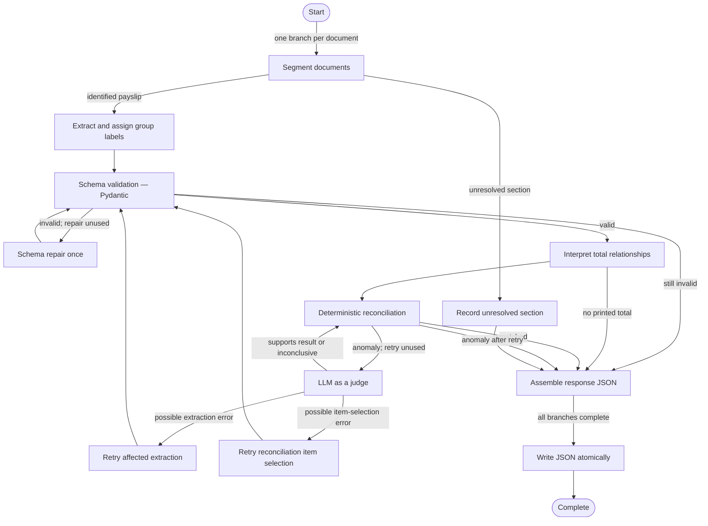

# Wage Extraction Agent — Solution Technique Summary

Solution: Wage Extraction Agent local mock prototype  
Version: 0.1.0; prompt bundle v2  
Status: Completed and accepted local mock prototype; live services unverified  
Prepared for: Management  
Prepared on: 8 November 2026  
Implementation and evaluation evidence reviewed: source, prompts, schemas, graph, rules, fixtures, 46 passing tests and JUnit evaluation evidence

## Executive summary

- Business purpose: Convert de-identified scanned payslip content into source-preserving, API-ready structured JSON for later case-manager calculations.
- Human responsibility retained: Case managers remain responsible for review, calculations and all claim decisions.
- Overall assurance position: The local mock prototype conforms to all six versioned synthetic scenarios and its deterministic contracts. This is not evidence of live OCR or GPT accuracy.
- Important limitations: Azure Document Intelligence and GPT are mocked; the LLM judge is uncalibrated; real-payslip generalisation, production security and integration remain unverified.
- Acceptance: Accepted by the Data Scientist on 8 November 2026 for local mock-prototype use only.

## Implemented LangGraph DAG

Orchestration implemented: LangGraph  
Implementation evidence reviewed: `workflow/graph.py`, `workflow/nodes.py`, route tests and synthetic end-to-end tests

- Main processing path: Segment, extract, structurally validate, interpret printed-total relationships, reconcile deterministically, assemble and publish JSON.
- Conditional and exception paths: Unresolved pages, structural repair, advisory judge review and targeted correction preserve partial results rather than stopping other branches.
- Retry behaviour: Up to two transport retries, one schema repair and one targeted reconciliation retry per check.
- Checkpoint and human-interrupt points: No persistent checkpoint or runtime interrupt in the local prototype; human review occurs downstream for visible partial, unreadable or unresolved outcomes.
- Differences from approved design: None material. Reconciliation source references were clarified and approved to include context-supported pay items or printed totals.

## 1. Prompting and context

| Technique | Management purpose | Where used | Implementation evidence | Status and evaluation result |
|---|---|---|---|---|
| Context delimitation | Prevent document text from becoming instructions | All document-facing stages | Shared `untrusted-content.md` and stage tags | Implemented; bundle rendering tests pass |
| Structured output prompting | Produce bounded machine-readable responses | All eight LLM stages | Code-owned schemas inserted through prompt variables | Implemented structurally; live accuracy unverified |
| Prompt chaining | Separate segmentation, extraction, relationship interpretation, judge and correction tasks | LangGraph LLM stages | Stage-specific prompt files and graph nodes | Implemented; mock route tests pass |
| Zero-shot baseline | Establish a simple baseline before representative examples exist | Prompt bundle v2 | No few-shot examples in stage files; B-003 records reassessment | Implemented; real-data comparison deferred |
| Versioned prompts | Support audit, evaluation and rollback | `prompts/v1` and `prompts/v2` | Immutable complete bundles, manifests and SHA-256 digest | Implemented; loader tests pass |

## 2. Guardrails and governance

| Technique | Management purpose | Where used | Implementation evidence | Status and evaluation result |
|---|---|---|---|---|
| Role-based guardrail | Constrain each model call to a narrow responsibility | Shared scope and stage prompts | System-scope and stage-specific instructions | Implemented; behavioral guidance only, not permission enforcement |
| Prompt-injection resistance | Treat embedded commands as untrusted data | Document, OCR and prior-model inputs | Shared untrusted-content rules; no model tools | Implemented in prompts; live adversarial effectiveness unverified |
| Abstention and escalation | Avoid invented certainty | Unknown, unreadable, unresolved and inconclusive outcomes | Schemas, prompts, status rules and issues | Implemented; synthetic cases pass |
| Human authority boundary | Prevent automated claim decisions | Entire solution | Prohibited-use rules and no action tools | Implemented; case managers retain decisions |
| Bounded repair | Prevent uncontrolled correction loops | Schema and reconciliation paths | Attempt counters and conditional routes | Implemented; route-limit tests pass |

## 3. Evidence and quality controls

| Technique | Management purpose | Where used | Implementation evidence | Status and evaluation result |
|---|---|---|---|---|
| Evidence grounding | Preserve where extracted values came from | Fields, items, totals and unresolved sections | Source page/location fields and evidence contracts | Implemented structurally; live locatability unverified |
| Structural validation | Keep API objects type-safe and complete | Every structured model response | Strict Pydantic models | Implemented; does not establish truth |
| Deterministic reconciliation | Cross-check context-selected source records against printed totals | Reconciliation node | Exact `Decimal` arithmetic, source/currency/self-reference checks | Implemented; synthetic cases pass |
| Controlled vocabulary | Add consistent optional grouping without replacing source labels | Pay-item group labels | Enum and deterministic known mappings | Implemented; live mapping quality unverified |
| Source preservation | Avoid silent deduplication or conflict removal | Extraction and response assembly | Duplicate/conflict fixtures and output models | Implemented; synthetic cases pass |
| LLM-based verification | Classify reconciliation anomalies and choose a bounded retry | Conditional judge node | Advisory judge outcomes and retry routes | Mock routing implemented; judge accuracy/calibration unverified |

## 4. Architecture and orchestration

| Technique | Management purpose | Where used | Implementation evidence | Status and evaluation result |
|---|---|---|---|---|
| LangGraph state orchestration | Make branching, joins and bounded retries explicit | Twelve-node graph | Registered nodes, conditional destinations and typed state | Implemented; graph/route tests pass |
| Failure isolation | Continue unaffected documents and payslips | Parallel document and payslip branches | Reducers, terminal branch IDs and partial statuses | Implemented; injected failures tested |
| Separation of interpretation and rules | Keep model judgement away from arithmetic and control | Prompt nodes versus rule nodes | LLM relationship selection followed by deterministic validation | Implemented; synthetic reconciliation passes |

## 5. Evaluation and observability

| Technique | Management purpose | Where used | Implementation evidence | Status and evaluation result |
|---|---|---|---|---|
| Versioned synthetic evaluation | Verify deterministic prototype conformance | Six synthetic documents | Expected results, mock responses and end-to-end tests | 46/46 tests pass |
| Failure-injection testing | Verify timeouts, malformed responses, retries and isolation | Mock adapters and graph tests | Versioned fault plans | Implemented; tests pass |
| Prompt release identity | Reconstruct the evaluated prompt release | Evaluation record | Bundle version and SHA-256 digest | Implemented in evaluation evidence; per-call live tracing deferred |

## 6. Integration and operations

| Technique | Management purpose | Where used | Implementation evidence | Status and evaluation result |
|---|---|---|---|---|
| Adapter boundary | Keep external OCR/model services replaceable | Document Intelligence and LLM protocols | Protocols and versioned mock adapters | Mock implementation verified; Azure adapters unimplemented |
| Safe output publication | Prevent half-written consumer files | Final write node | Same-directory temporary write and atomic replacement | Implemented; publication tests pass |
| API-ready response contract | Provide a stable Jade-facing payload boundary | Final response model | Strict response schema and JSON projection | Implemented locally; Jade integration unverified |

## Proposed, deferred, experimental, or unverified techniques

| Technique | Status | Intended purpose | Dependency or next step |
|---|---|---|---|
| Live Azure Document Intelligence | External and unverified | OCR and layout extraction | AI Engineering integration and representative evaluation |
| Live GPT execution | Unimplemented | Execute versioned prompts against source context | Approved live adapter and controlled credentials |
| Calibrated LLM judge | Unverified | Improve anomaly triage | Human-labelled anomaly set and calibration thresholds |
| Few-shot or optimized prompting | Deferred | Improve recurring extraction errors | Representative development and held-out payslip sets |
| Production observability and security | Out of prototype scope | Operate safely at scale | AI Engineering deployment review and named owners |

## Limitations and management considerations

- Techniques implemented but not yet validated: live prompt-injection resistance, live evidence accuracy, group mapping quality and judge effectiveness.
- Material residual risks: synthetic samples do not represent employer/layout diversity, scan degradation or live service behavior.
- Human review or operational dependencies: case-manager review remains required; production controls and service ownership remain external dependencies.
- Recommended follow-up: integrate controlled live services, build human-gold datasets, measure fact precision/recall and unsupported-value rate, calibrate the judge, and set production thresholds before any operational release.
